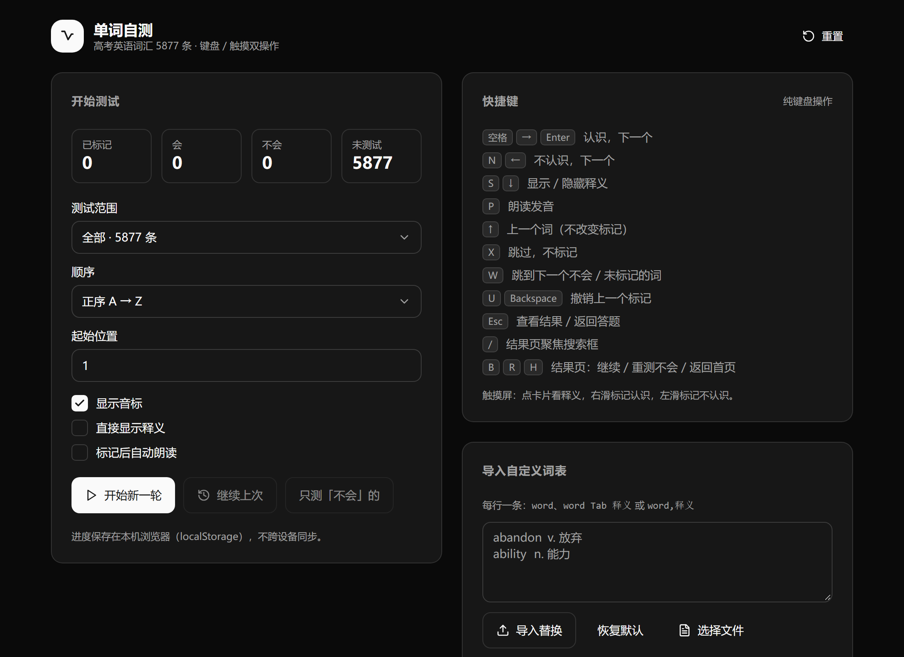

# 单词自测 · 高考英语词汇

一个用来快速盘点「哪些高中英语单词我还不会」的自测工具。逐词标记会 / 不会，结果可导出成生词本 PDF、CSV 或 TXT。

在线使用：**https://gaokao-word-self-test.app.workbuddy.host/**



> 纯前端、无后端。学习进度保存在浏览器 `localStorage`，不跨设备同步，也不会上传到任何服务器。

## 功能

- **5877 条词库**，来自三个可追溯的源头（见下）
- **分层**：教育部课标 / 高考词书 / 教材共识 / 四六级衔接，另有 **1846 条初中基础词**单独成层
- **测试范围**：全部、高考核心、仅课标、仅初中基础、高中及以上（跳过基础）、仅四六级衔接
- **顺序**：正序、随机、按优先级、高频优先、低频优先
- **快捷键全流程可操作**：`空格` 认识 / `N` 不认识 / `S` 释义 / `P` 朗读 / `↑` 上一个 / `X` 跳过 / `W` 跳到下一个生词 / `U` 撤销
- **触摸屏**：点卡片看释义，右滑标记认识，左滑标记不认识
- **导出**：生词本 PDF（A4 双栏，含音标释义）、默写版 PDF（释义留白 + 答案）、CSV、TXT、复制到剪贴板
- 结果页可按层级 / 状态 / 常用度筛选，支持搜索

## 技术栈

React 19 + TypeScript + Vite 7 + Tailwind CSS v4 + [shadcn/ui](https://ui.shadcn.com/)（Radix primitives）。

配色为纯灰阶黑白——所有色值 `oklch()` 的彩度分量为 0，状态区分靠填充 / 描边和明度差，不依赖颜色。

## 本地开发

```bash
cd app
npm install
npm run dev        # 开发服务器
npm test           # 61 项渲染 + 逻辑测试
npm run build      # 构建到 ../dist
```

构建产物是纯静态文件，`dist/` 可直接托管。

## 词库是怎么来的

`data/` 下的 JSON 由 `tools_*.py` 生成，不是手工整理的。

| 来源 | 用途 |
|---|---|
| 教育部《普通高中英语课程标准》附录词汇表 | 课标层，3094 词 |
| 教育部《义务教育英语课程标准（2022 年版）》附录 3 | 初中基础词判定，三级 1600 词 |
| [LinXueyuanStdio/DictionaryData](https://github.com/LinXueyuanStdio/DictionaryData) | 星火《最新高考词汇必背乱序版》、6 个版本初中教材、音标、释义 |
| [ECDICT](https://github.com/skywind3000/ECDICT) | 音标与释义兜底、词频、柯林斯星级 |

**初中基础词怎么判定**：统计一个词在 49 本初中教材 / 中考词书里出现几本，阈值取 8 本。

这个阈值不是拍脑袋定的——命中本数的分布是**双峰**的，谷底正好落在 7/8 之间（7 本只有 110 条，8 本突然涨到 318 条）。切在谷底最干净。

校验方式：拿教育部义务教育课标的 1600 词表反查，**判对率 100%**（1620 个能对上的词全部判为基础词，其中带 `*` 的 148 个小学词也全部命中）。

`data/src/` 下的原始 PDF 与 CSV **未包含在仓库中**（体积大且涉及版权），需要时按 `tools_build_words.py` 里的文件名自行获取。

### 重新生成词库

```bash
python tools_build_words.py    # 输出 data/words.json 与 app/src/data/words.json
```

两份内容一致：前者供其它脚本流转，后者直接给 React 项目用。

## 目录

```
app/                React 项目
  src/
    components/     HomeView / CardView / ResultView
    components/ui/  shadcn/ui 组件
    lib/            quiz(排序筛选) / exports(导出) / store(存档)
    data/words.json 词库
  test/             渲染与逻辑测试
data/               词库产物与中间数据
legacy/             第一版实现（零依赖静态页，已归档）
tools_*.py          词库生成、OCR 提取、PDF 排版验证脚本
dist/               构建产物
```

`legacy/` 是早期的原生 JS 单页实现，已被 React 版取代，仅作对照保留。

## 许可

代码 MIT。词库内容来自上述公开数据源，版权归各自所有者。
